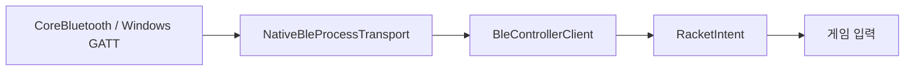

# Digital Tennis BLE SDK

**Bluetooth 라켓을 게임에서 사용할 수 있는 입력으로.** macOS·Windows의 기기 검색과 연결을 처리하고, 검증된 라켓 이벤트를 순수 C# API로 전달합니다.

[빠른 시작](#빠른-시작) · [사용 예](#사용-예) · [연결 구조](docs/architecture.md) · [기여하기](CONTRIBUTING.md)

## 제공하는 기능

Unity 게임 코드에서 OS별 Bluetooth 처리를 분리하려는 개발자를 위한 SDK입니다. `Runtime/`은 **netstandard2.1**이며 UnityEngine에 의존하지 않습니다.

- **기기 검색·선택:** Digital Tennis GATT 서비스를 광고하는 기기만 찾습니다.
- **OS 연결·보안 확인:** 페어링 상태를 표시하고, 보호된 특성에서 현재 상대의 암호화·본딩 증거를 확인합니다.
- **이벤트 검증:** CRC·범위·순번·수신 시각을 검사하고 중복·오래된 입력을 제거합니다.
- **별도 준비 단계:** 센서 없는 통신 확인과 센서 보정을 독립적으로 처리합니다.
- **연결 수명 관리:** 연결이 바뀌면 이전 작업·보정·대기 입력을 폐기합니다.
- **전송 교체:** `IBleTransport`로 실제 OS 전송과 테스트용 전송을 분리합니다.



스윙 분류는 [펌웨어](https://github.com/digital-tennis/digital-tennis-firmware), 바이트 규격은 [protocol](https://github.com/digital-tennis/digital-tennis-protocol), 타격·점수 판정은 [게임](https://github.com/digital-tennis/digital-tennis-game)이 담당합니다.

## 빠른 시작

### C# 라이브러리 검사

**.NET 10 SDK, Python 3, Git**을 준비하고 두 저장소를 같은 부모 폴더에 받습니다.

```sh
git clone https://github.com/digital-tennis/digital-tennis-protocol.git
git clone https://github.com/digital-tennis/digital-tennis-ble-unity.git
cd digital-tennis-ble-unity
dotnet run --project tests/Checks.csproj -c Release
```

기본 protocol 경로는 `../digital-tennis-protocol`입니다. 다른 위치라면 명령에 `-p:ProtocolRoot=/absolute/path/to/digital-tennis-protocol`을 추가합니다. 이 검사는 모의 전송을 사용하며 실제 Bluetooth에 접속하지 않습니다.

### 네이티브 모듈 빌드

macOS는 **Command Line Tools/Swift와 macOS SDK**, Windows 모듈은 **.NET 10 SDK**가 필요합니다.

```sh
python3 tools/build-native.py --platform mac --out .work/native/mac
# Windows용 모듈을 만들 때
python3 tools/build-native.py --platform windows --out .work/native/windows
```

Mac 결과는 `digital-tennis-ble` universal 실행 파일입니다. Windows 결과는 self-contained x64 모듈과 런타임 고지입니다. 빌드만으로 OS 권한을 바꾸거나 기기를 검색하지 않습니다. 결과물의 `Licenses/`도 함께 배포합니다.

## 사용 예

다음 클래스는 네이티브 모듈 경로를 받아 SDK를 만들고, 애플리케이션의 업데이트 루프에서 수신 이벤트를 전달합니다. `submit`에는 게임의 일반 입력 경계를 연결합니다.

```csharp
using System;
using System.Diagnostics;
using DigitalTennis.Controller;

public sealed class RacketSession : IDisposable
{
    private readonly Stopwatch clock = Stopwatch.StartNew();
    public BleControllerClient Client { get; }
    public double Now => clock.Elapsed.TotalSeconds;

    public RacketSession(string helperPath)
    {
        Client = new BleControllerClient(
            new NativeBleProcessTransport(helperPath, () => Now));
    }

    public void Update(Action<RacketIntent> submit)
    {
        Client.Tick(Now);
        while (Client.TryRead(out var intent))
            submit(intent);
    }

    public void Dispose() => Client.Dispose();
}
```

동일한 `RacketSession`을 연결 화면과 게임 수명 동안 유지하고, `Update`를 메인 스레드에서 반복 호출합니다. worker에서도 읽는 시계에는 thread-safe 단조 시계를 사용하며, Unity 시각을 worker에서 직접 호출하지 않습니다.

| 사용자 동작 | API | 완료 확인 |
| --- | --- | --- |
| 기기 찾기 | `Client.Scan()` | `Client.Devices`에 검색 결과 표시 |
| 목록에서 연결 | `Client.Connect(device.Id)` | `State == BleLinkState.Connected`와 `BondVerified` |
| 통신 확인 | `Client.ProbeLink(session.Now)` | `LinkProbePassed`, `LinkRoundTripMs` |
| 센서 보정 | `Client.Calibrate(session.Now)` | `Calibrated` — 명령 접수와 완료는 다름 |
| 화면 종료·연결 해제 | `Client.Disconnect()` / `session.Dispose()` | 연결·입력 정리 |

`device.Id`는 검색된 목록에서 사용자가 선택한 값이어야 합니다. `Connect`의 반환값은 요청 접수 여부입니다. OS 승인과 본딩 확인은 비동기로 진행되며 상태·오류를 화면에 표시해야 합니다.

### Unity에 넣기

UPM 패키지 이름은 `com.digital-tennis.controller`입니다. protocol 패키지 `com.digital-tennis.protocol`도 함께 추가하고 두 Git 참조를 검토한 커밋으로 고정합니다. 네이티브 모듈은 실행 플랫폼에 맞춰 포함해야 합니다. [게임의 고정 패키지 설정](https://github.com/digital-tennis/digital-tennis-game/blob/main/Packages/manifest.json)과 [빌드 배포 구조](docs/architecture.md)를 참고하세요.

## 지원·검증 범위

| 대상 | 구현 | 확인 범위 |
| --- | --- | --- |
| 공통 SDK | 검색·연결 상태, 패킷·보정·링크 검사 | 독립 .NET 검사와 Unity 통합 검사 |
| macOS | CoreBluetooth, arm64/x86_64 모듈 | 빌드·실제 NU-54 본딩·테니스 왕복·보드 재시작 후 재연결 확인 |
| Windows | WinRT GATT·OS 페어링, x64 모듈 | 교차 빌드 확인. 실물 Windows 본딩은 미검증 |
| 외장 IMU | 보정·정규화 이벤트 수신 경계 | 실제 센서 장착·제스처 검증은 유예 |

대상 제품은 **NU40-DK + 별도 외장 IMU**입니다. NU-54는 센서 없는 시험용입니다. `LINK_REPLY` 성공은 센서 보정이나 경기 입력 준비를 뜻하지 않습니다. 실제 기기 검증 이력은 [게임의 본딩 검수](https://github.com/digital-tennis/digital-tennis-game/blob/7af42a20b42975b21a41ab3f7055c6846fb510e9/docs/controller-bonding.md)를 확인하세요.

## 문서·소스

[플랫폼 경계·배포·진단](docs/architecture.md) · [클라이언트 API](Runtime/BleControllerClient.cs) · [네이티브 전송](Runtime/NativeBleProcessTransport.cs) · [제품별 개발 과제](https://github.com/digital-tennis/digital-tennis-docs/blob/main/docs/products/digital-tennis-ble-unity.md)

## 도움말·기여

[Digital Tennis](https://github.com/digital-tennis)가 관리합니다. [Issues](https://github.com/digital-tennis/digital-tennis-ble-unity/issues)에 OS, SDK·펌웨어 버전, 연결 단계와 오류 상태를 남겨 주세요. 기기 식별자·본딩 키는 제외합니다. 전송 구현을 추가할 때는 [기여 안내](CONTRIBUTING.md)를 따릅니다.

## 라이선스

직접 작성한 코드·문서는 [Apache-2.0](LICENSE)입니다. [NOTICE](NOTICE)와 [외부 런타임 고지](THIRD_PARTY_NOTICES.md)를 함께 배포합니다.

### 버튼 프로필과 IMU 프로필

현재 본딩 연결의 LINK_PROBE에 대응한 LINK_REPLY.kind=1은 버튼 프로필입니다. 이 경우에만 v2 BUTTON4/5/6/7을 서브/포핸드/백핸드/스킬 의도로 전달합니다. UseGameShotSettings는 측정값이 없는 버튼임을 뜻하며 소비 게임의 CSV 기본 세기를 사용합니다. Calibrated는 계속 거짓이고 SWING은 거부합니다. kind=0 IMU 프로필은 기존 보정 ACK와 motion-ready를 요구합니다. 연결 해제·잘못된 nonce·만료·중복 입력은 권한을 부여하지 않습니다.

## 물리 이벤트 v3

새 프로필은6종 물리 회전 패턴과 번호별 버튼 눌림/해제를 그대로 제공합니다. SDK는 서브·스매시·발리·Skill을 선택하지 않으며 그 판단은 게임에 있습니다. 기존 v1/v2 입력은 호환 경로로 구분합니다. 프로필 응답과 보정 ACK·본딩·시각·중복 gate는 유지됩니다. 새 기기는 v3을 이해하는 게임/SDK를 함께 사용해야 합니다.
