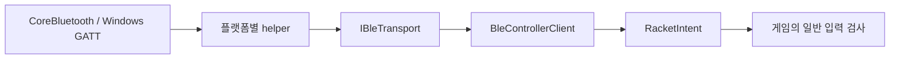

# BLE SDK의 플랫폼 경계와 통합

## 책임

`Runtime/`은 UnityEngine 없는 netstandard2.1 라이브러리입니다. 게임은 OS API 대신 `BleControllerClient`의 기기·상태·검증된 `RacketIntent`를 사용합니다. 패킷 형식은 별도 [protocol](https://github.com/digital-tennis/digital-tennis-protocol)이 소유하며, 스윙 분류는 펌웨어가 담당합니다.



`NativeBleProcessTransport`는 사용자 검색·연결 요청 시에만 helper를 실행합니다. 실제 흐름에 가짜 장치를 추가하거나 자동 mock으로 대체하지 않습니다. 게임의 `IControllerBackend`가 SDK를 감싸며 입력 라우터에 연결합니다.

## 연결과 본딩

```text
Disconnected → Scanning → 사용자가 기기 선택 → Connecting → Pairing → Connected
```

- 검색 결과는 서비스 UUID를 광고하는 기기만 포함합니다. 연결 ID는 현재 검색 결과에 있어야 합니다.
- macOS는 CoreBluetooth의 보호된 GATT 읽기·구독으로 OS 보안 절차를 진행합니다. Windows는 WinRT GATT와 OS `PairAsync`를 사용합니다.
- `connected` 이벤트만으로 완료하지 않습니다. 현재 선택한 peer의 보호된 4바이트 링크 상태가 암호화 level≥2와 본딩을 증명해야 합니다.
- macOS의 암호화 대기 ATT 오류 5/15는 제한 재시도하며, SDK 전체 연결 대기는 60초입니다. 시간 초과·거절을 성공으로 처리하지 않습니다.
- OS 키 데이터베이스를 직접 읽거나 권한을 자동 승인·초기화하지 않습니다.

링크 상태의 단위와 flags는 [정본 ICD](https://github.com/digital-tennis/digital-tennis-protocol/blob/main/spec/controller-v2.md)를 따릅니다. 현재 화면 없는 시험 펌웨어는 사용자 승인된 SC+Just Works이며 PIN·숫자 대조 MITM 인증은 없습니다.

## 통신 확인과 보정

`ProbeLink(now)`는 v2 LINK_PROBE를 쓰고 같은 연결·nonce의 LINK_REPLY를 2초 동안 기다립니다. WriteWithResponse, 알림 구독, 애플리케이션 응답은 별도 단계입니다. 센서가 없어도 응답할 수 있지만 보정·게임 입력·설정 저장을 완료하지는 않습니다.

`Calibrate(now)`는 같은 연결의 명령 ID에 대응하는 성공 ACK와 ready/calibrated flags를 5초 동안 기다립니다. BUSY는 진행 상태이며 완료가 아닙니다. 실패·timeout·단절은 보정 미완료로 남깁니다. 보정 전·진행 중 스윙은 차단합니다.

## 시각·입력 수명

helper 콜백은 실제 worker 수신 시 **PC 단조 시각**과 불변 operation을 기록합니다. 조립 시 thread-safe `Func<double>` 시계를 주입하며 Unity API를 worker에서 호출하지 않습니다. MCU 시각이나 나중에 큐를 비운 시각으로 입력을 새롭게 만들지 않습니다.

클라이언트는 잘못된 CRC·범위, 200ms 초과·20ms 미래·비유한 시각, 이전 operation, 오래된 순번과 중복 이벤트를 거부합니다. 원시 이벤트는 제한 큐를 거쳐 `Tick`에서 처리합니다. `ClearInput`은 스윙을 비우되 보정 ACK·연결 상태 처리는 보존합니다.

연결 종료·교체 시 epoch·보정·대기 입력을 폐기합니다. helper의 쓰기는 제한 큐에서 응답을 기다려 직렬화합니다. 게임은 SDK를 통과한 입력에도 차례·거리·높이·스킬 재고를 다시 검사합니다.

## 빌드·배포

```sh
dotnet run --project tests/Checks.csproj -c Release -p:ProtocolRoot=/absolute/path/to/digital-tennis-protocol
python3 tools/build-native.py --platform mac --out .work/native/mac
python3 tools/build-native.py --platform windows --out .work/native/windows
```

Mac은 macOS 12 이상을 타깃으로 하는 arm64/x86_64 universal 모듈이며 Bluetooth 사용 목적 plist를 포함합니다. Windows는 self-contained x64 모듈입니다. 실제 실행 OS·권한 검수는 별도로 필요합니다.

UPM `com.digital-tennis.controller`와 `com.digital-tennis.protocol`의 Git 참조를 검토한 커밋으로 고정합니다. 네이티브 출력과 `Licenses/`를 해당 플랫폼 게임에 함께 배포하며 바이너리는 Git에 넣지 않습니다. 게임 빌드 후처리는 고정 SDK 소스로 `StreamingAssets/ControllerNative/`를 생성합니다.

## 실제 기기 진단

```sh
python3 tools/probe-link.py --helper .work/native/mac/digital-tennis-ble --scan --out .work/scan.json
python3 tools/probe-link.py --helper .work/native/mac/digital-tennis-ble --device '선택한 ID' --out .work/link.json
```

이 두 명령은 명시적으로 실행할 때 실제 Bluetooth를 사용합니다. 기기 식별자가 포함될 수 있는 로컬 결과는 공개하지 않습니다. 진단 콜백은 길이·이벤트 종류·오류 타입만 기록하며 원시 식별자·OS stderr를 노출하지 않습니다.

현재 실제 검색 확인과 최종 OS 본딩·테니스 왕복 미완료를 구분합니다. Windows 실물·외장 IMU 정확도도 별도 검수입니다. 최신 결과는 [게임 본딩 기록](https://github.com/digital-tennis/digital-tennis-game/blob/main/docs/controller-bonding.md)을 기준으로 합니다. 제품 타깃은 NU40-DK+별도 외장 IMU이며 NU-54는 센서 없는 시험용입니다.

## 참고한 연결 패턴

사용자 제공 NU-54 참고 제품의 `p01-device-firmware/app/src/ble_links.c`와 `p05-operations-backoffice/internal/ble/central.go`에서 서비스 발견·구독 확인·순차 WriteWithResponse·연결 수명 패턴을 검토했습니다. 참조 커밋은 `ee12b7519336ed276060b83c69f4f863f557443a`입니다. 지갑·결제·프로비저닝 기능은 테니스 SDK에 포함하지 않습니다.

공식 API: [Apple CBCentralManager](https://developer.apple.com/documentation/corebluetooth/cbcentralmanager) · [Microsoft GATT Client](https://learn.microsoft.com/en-us/windows/apps/develop/devices-sensors/gatt-client)

[README로 돌아가기](../README.md)
